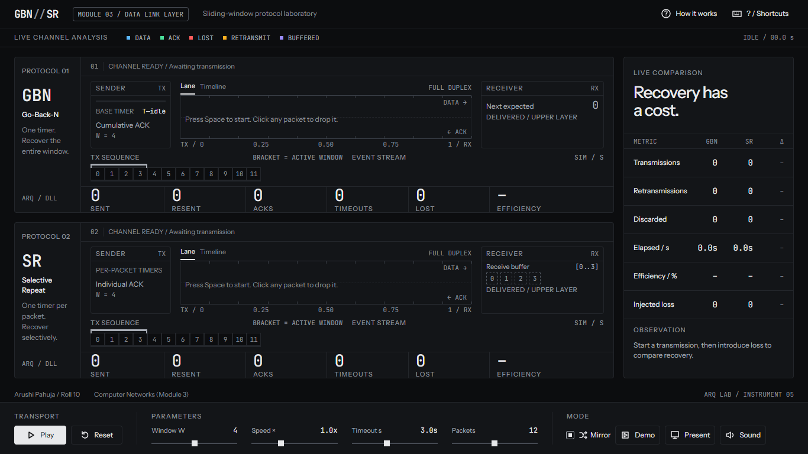
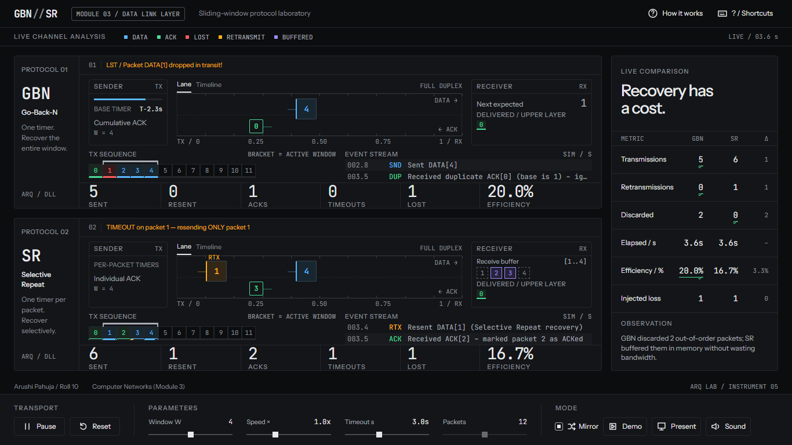
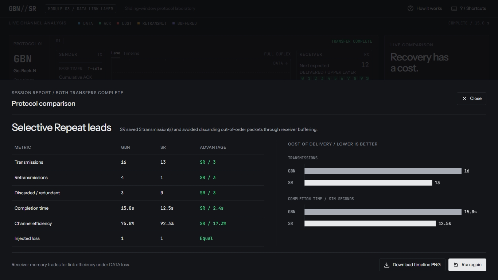
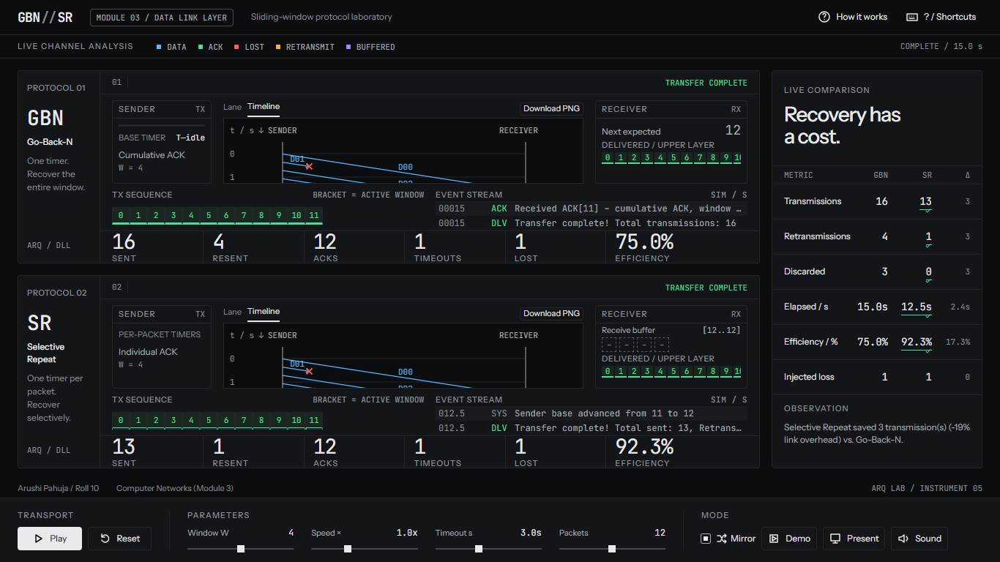
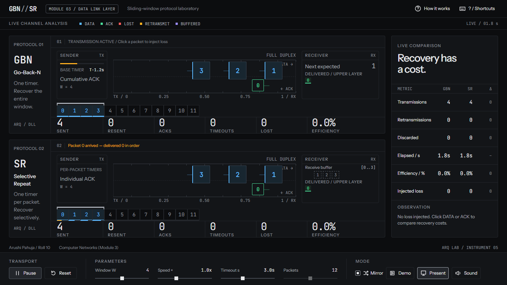
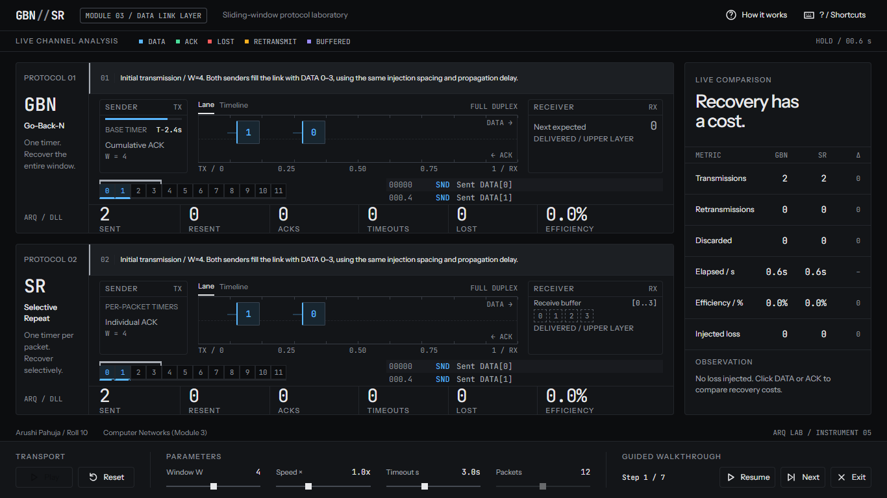

# Real-Time Go-Back-N vs. Selective Repeat Arena

Computer Networks, Module 3 — Data Link Layer. A live comparative sliding-window
laboratory for demonstrating flow control, packet loss and recovery.

Double-click **index.html**. No installation, framework or build step is required.
The application works directly through file URLs. Instrument Sans and JetBrains
Mono from Google Fonts are bundled locally, so the intended typography works
offline. Arial and Consolas remain fallbacks if a font file is unavailable.
Chrome, Edge and Firefox support the core simulation and canvas export.

## Visual reference

These Phase 5 capture slots are populated by the browser QA runner. Re-run them
after changing the presentation. Both target resolutions are included in
[docs/screenshots](docs/screenshots).

| Instrument panel | Mirrored sequence-1 loss | Final session report |
| --- | --- | --- |
|  |  |  |

| Space-time view | Projector view | Guided narration |
| --- | --- | --- |
|  |  |  |

Optional future recording placeholder: docs/screenshots/guided-demo.webm.
The exported full-height diagram is separate from the viewport screenshot.

## Design decisions

The interface borrows from oscilloscopes, logic analyzers and technical manuals:
a slim wordmark bar, two stacked instrument rows, a narrow comparison rail and a
docked control bar. Warm near-black surfaces, hairlines, small radii and aligned
monospaced readouts establish hierarchy without gradients, blur or resting
shadows. Signal colors describe events, not protocol identity: blue DATA, green
ACK, red loss/discard, amber timeout/retransmission, violet buffered state. Packet
travel is linear and derives from simulation time; brief state transitions honor
reduced-motion preferences.

The desktop layout fits 1366×768 and expands to 1920×1080. Smaller screens use a
scrolling layout to preserve usable controls. Sequence rulers and delivered strips
scroll horizontally for long runs; timelines and terminals scroll within their
own regions. The dock occupies a grid row and cannot cover arena content.

## Operating the laboratory

1. Press Space or Play. Both protocols share the same simulation clock.
2. Click an in-flight DATA square to drop it. Mirror is enabled by default, so the
   matching DATA sequence is dropped in the other arena.
3. Observe GBN discarding out-of-order arrivals while SR stores them in its buffer.
4. Compare timeout recovery, retransmissions, discarded packets and efficiency.
5. Switch either arena from Lane to Timeline to inspect the full event history.
6. Pause to scroll. Download PNG exports the whole run, including offscreen
   history. The final sheet exports both timelines in one image.

ACKs are outlined green squares on the lower lane and can also be dropped.
ACK loss is **never mirrored**. Packets are keyboard focusable; Enter or Space drops
a focused packet. Terminal rows have native tooltips for their complete messages.

| Key | Action |
| --- | --- |
| Space | Play / pause |
| R | Reset the session, counters and timeline histories |
| D | Start / exit the seven-step guided demo |
| M | Toggle mirrored DATA loss |
| P | Presentation mode: larger packets/type, hides logs and timeline tabs |
| S | Toggle synthesized Web Audio; off by default |
| ? | Keyboard reference and protocol verification |
| Esc | Close a dialog or exit the active guided demo |

Native activation takes precedence when a button, range or checkbox has focus.
Dialogs contain keyboard focus and restore it when dismissed.

The guided demo configures W=4, 12 packets, 1× speed and a 3-second timeout. It
introduces DATA losses at sequences 1 and 6 and a GBN ACK loss, narrating receiver
behavior and recovery in the arena event strips. Pause preserves the remaining
narration delay; Next advances one step; Exit continues free play.

| Parameter | Range | Default |
| --- | --- | --- |
| Sender window W | 1–7 | 4 |
| Speed | 0.5×–2× | 1× |
| Timeout | 1–6 simulation seconds | 3 s |
| Total packets | 4–20 | 12 |

DATA propagation is 1.6 simulation seconds and ACK return is 1.2. A timeout below
the round-trip time can trigger retransmission without injected loss.
Sequence numbers increase without wraparound in this educational simulation.
Changing total packets starts a clean session; the packet-count slider is disabled
during playback. Window size, speed and timeout remain adjustable live.

## Protocol correctness

| Property | Go-Back-N | Selective Repeat |
| --- | --- | --- |
| ACK(n) | Confirms every packet ≤ n | Confirms only packet n |
| Receiver window | 1 | W |
| Out-of-order DATA | Discard; re-ACK last in-order packet | Buffer within receive window |
| Sender timer | One timer for oldest unacknowledged packet | Independent timer per packet |
| Timeout recovery | All outstanding packets in the window | Only the expired packet |
| Delivery | In order | In-order buffered prefix |
| m-bit sequence bound | W ≤ 2ᵐ − 1 | W ≤ 2ᵐ⁻¹ |
| Trade-off | Simple receiver, more link work under DATA loss | Receiver memory, selective recovery |

Efficiency is unique delivered packets / total DATA transmissions. The discarded
metric includes redundant already-delivered SR arrivals after an ACK is lost;
SR's zero-waste advantage applies to the demonstrated DATA-loss scenario, not
every possible ACK-loss pattern. Completion times use the simulation clock.
Live deltas are absolute differences; a green underline and SVG check identify the
better value. Elapsed time gets a winner after both protocols finish.

## Files and boundaries

| File | Responsibility |
| --- | --- |
| index.html | Layout, instrument blocks, controls, drawers and canvases |
| styles.css | Tokens, responsive grids, packet/cell states, reduced motion |
| engine.js | EventBus, SimConfig, SimClock, Packet and Web Audio |
| gbn.js | GBN state, cumulative ACKs, single base timer and existing renderer |
| sr.js | SR state, individual ACKs, packet timers, buffering and renderer |
| main.js | Transport, parameters, scoreboard, demo, results and self-tests |
| view.js | Presentation adapter, SVG icons, terminal formatting, linear packet paint, timeline recording/export and focus handling |
| tests/qa.cjs | Optional development-only headless browser QA |
| tests/audit.cjs | Fonts, contrast, banned styles, native motion and offline QA |
| assets/fonts | Bundled Google Fonts and their OFL licenses |
| AGENTS.md | Maintenance rules and verification instructions |

Scripts load in that order through global browser modules. Protocols publish log,
stat, done and mirror:drop events. The view subscribes to those events and the
clock. Its packet-position pass runs after protocol ticks, changing only DOM paint.
The timeline adapter parses existing log messages into flights and receiver/timeout
marks; preserve those messages or update the adapter when changing logging in a
future phase. All events are recorded; canvas repainting is limited to 30 Hz.
Reset clears recordings, count-up animations and packet nodes.

**Phase 5 adds no logic hooks. engine.js, gbn.js and sr.js remain unchanged.**
The maintenance hard rule is in [AGENTS.md](AGENTS.md).

## Verification

Open the browser console and run:

~~~js
runTests()
~~~

Or press ? and choose **Run Protocol Verification**. The runner resets the session
and must return three passing results:

1. W=4, total=4, lose DATA[1]: GBN retransmits three outstanding packets; SR one.
2. GBN discards out-of-order packets; SR buffers those arrivals with zero waste.
3. With a 4.5-second timeout, GBN tolerates ACK[0] loss when a later cumulative
   ACK arrives before the deadline.

Development-only QA requires Playwright and Chrome/Edge; the app requires neither.
With Playwright resolvable from Node, run:

~~~powershell
node tests/qa.cjs
node tests/audit.cjs
$env:QA_FULL = '1'
node tests/qa.cjs
~~~

Use NODE_PATH for an existing Playwright package directory and BROWSER_PATH for an
alternate browser executable. QA opens index.html through file URLs, uses a paused
virtual browser clock for repeatable full runs and produces PNGs plus
[qa-report.json](docs/screenshots/qa-report.json). It checks both target resolutions,
W=1–7 at 0.5×/2×, 20-packet runs, DATA and ACK drops, demo controls, pause/resume,
DOM/subscription cleanup, presentation, focus containment and PNG downloads.

Manual presentation checklist:

- At both target sizes inspect idle, mid-loss and final report: no page scroll,
  clipped labels, overlapping lanes or controls covering content.
- Drop DATA[1] with Mirror on, then turn Mirror off and drop only one arena.
- Drop ACK[0]; use a timeout above round-trip delay for the cumulative-ACK demo.
- Pause/resume repeatedly, reset mid-run and start again; no stale report or packets.
- Run D end to end; check Pause, Next, Exit, P, S, ? and How it works.
- Pause and scroll both timelines; export one diagram and the combined PNG.
- Navigate with Tab; confirm focus rings and dialog focus return.
- Enable reduced motion and disconnect networking; the simulator remains usable.

Font sources: [Instrument Sans](https://github.com/google/fonts/tree/main/ofl/instrumentsans)
and [JetBrains Mono](https://github.com/google/fonts/tree/main/ofl/jetbrainsmono).
Both are distributed under the SIL Open Font License; license texts accompany
the local font files in assets/fonts.

## Student information

Arushi Pahuja · Roll No. 10
Computer Networks, Module 3 — Data Link Layer / Sliding-Window Protocols
